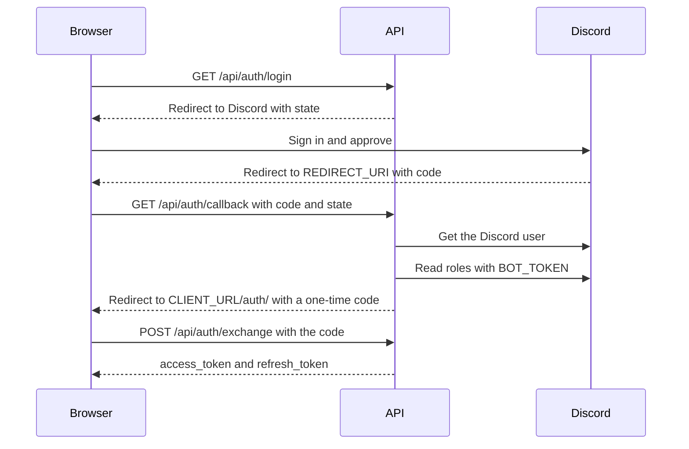
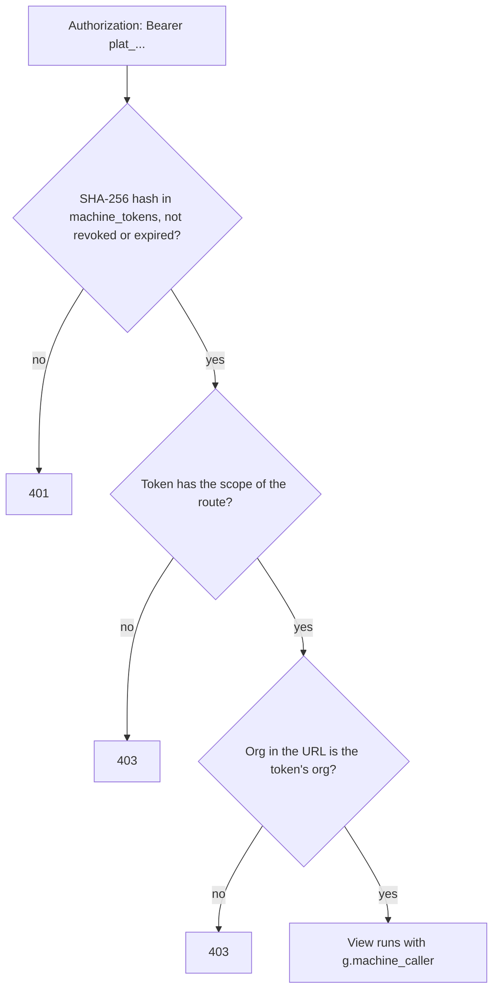

# Authentication

This page tells you how callers sign in and how a route decides who may call it. The code is in `modules/auth/`.

## Credentials

| Credential | Who uses it | Made by |
| --- | --- | --- |
| Platform access token and refresh token | Officers in `dashboard/` | Discord sign-in at `/api/auth/login` |
| Session cookie | The same officers, and members who signed in with Discord | Flask, signed with `SECRET_KEY` |
| Clerk session token | Members on the public website storefront | Clerk |
| Machine token (`plat_...`) | Apps, agents and CLIs | An officer, the Godfather CLI sign-in, or OAuth on the MCP server |
| App token | Older integrations | `GET /api/auth/appToken`. Use a machine token for new work |

## Officer sign-in

1. The browser opens `GET /api/auth/login`. The API stores a random `state` in the session and sends the browser to Discord.
2. Discord sends the browser to `REDIRECT_URI` (`/api/auth/callback`) with a code.
3. The API checks the `state`, gets the Discord user, and finds the orgs where the user has the officer role. It reads the roles over Discord's REST API with `BOT_TOKEN`.
4. If the user is an officer of one or more orgs, the API makes a token pair. It sends the browser to `<CLIENT_URL>/auth/?code=...` with a one-time code that is valid for 60 seconds. If the user is not an officer, the URL has `error=Unauthorized Access`.
5. The client sends the code to `POST /api/auth/exchange` and gets `access_token` and `refresh_token`.

This diagram shows the same steps.

With `?client=dashboard`, step 4 uses `DASHBOARD_URL` in place of `CLIENT_URL`. If `BOT_TOKEN` is not set or Discord does not answer, the callback returns 503.

The API keeps the one-time codes in process memory. Thus the API runs one gunicorn worker.

## Platform tokens

`modules/auth/tokens.py` signs tokens with RS256. The key pair is in `./data/jwt_private.pem` and `./data/jwt_public.pem`. The API makes the pair at the first start.

Caution: do not delete the key files. If you delete them, all tokens become invalid and every officer must sign in again.

- An access token is valid for 30 minutes. It has `username` and `discord_id`.
- A refresh token is valid for 7 days. The database keeps only its SHA-256 hash.
- `POST /api/auth/revoke` and `POST /api/auth/logout` delete the refresh token and write the access token to `revoked_tokens`. A revoked token stays revoked after a restart and in every process.
- An app token is valid for 120 days and has `type: "app"` and the `discord_id` of the officer who made it. Officers list and revoke their app tokens at `/api/auth/appTokens`.

Clients use the status code to decide what to do:

- 401: the token is missing or invalid. Sign out.
- 403 on a token in the `Authorization` header: the token is expired. Call `POST /api/auth/refresh`, then send the request again.

A bad or expired token in the session cookie always gets 401.

## Machine tokens

An officer makes a machine token with `POST /api/organizations/<id>/tokens` (`name`, `kind` of `app`, `agent` or `cli`, `scopes`, optional `expires_days`, optional `limits`). `limits` narrows the tools of a connected service, such as `{"github": {"repos": ["my-org/*"], "tools": ["github.*issue*"]}}` ([integrations](./integrations.md#tools-for-agents)). The response shows the token once. The database keeps its SHA-256 hash and its first characters. `DELETE .../tokens/<id>` revokes it. A machine token with `tokens:manage` can do the same with the `tokens.*` tools. A token that it makes gets only its scopes and its limits.

- A machine token belongs to one org. A route for a different org refuses it with 403.
- A module declares its scopes with `scopes.declare(name, description, integration=None, uses=())` from `modules/auth/scopes.py`. `integration` names the service whose own tools the scope gives. `uses` names the services that the scope calls with the org's keys, such as `knowledge:read` and `embeddings`.
- `GET .../tokens` lists all scopes and, under `uses`, the services each scope calls. Under `integrations` it lists every integration: whether the org connected it, its own scopes, the tools each scope gives (`tools`), whether the tools come from the service's MCP server (`remote`), the Platform scopes that call it (`through`), the modules that use it (`used_by`), and its limits. The Tokens page shows each integration's scopes with their tools, and marks a Platform scope that calls a service with the service icon.
- Officer routes do not accept a machine token. It is not a JWT, so they return 401.
- `GET /api/auth/machine/whoami` returns the org, name, kind and scopes of a token.

`machine_scope_required` checks a machine token in this order.

## OAuth for MCP clients

The MCP server is also an OAuth 2.1 authorization server, so an MCP client can connect with no token to paste. The client identifies itself with a Client ID Metadata Document, or registers itself (dynamic client registration, RFC 7591). An officer signs in with Discord and approves an org, scopes and integration limits. The client then gets a machine token of kind `oauth`. The code is in `modules/mcp/`: `oauth.py`, `oauth_pages.py`, `client_auth.py` and `edges.py`. The `mcp` SDK serves the protocol routes. The rules follow the MCP spec of 2026-07-28.

The public URL of the MCP server is `<ACCOUNTS_BASE_URL>/mcp`, such as `https://api.thesoda.io/mcp`. `MCP_PUBLIC_URL` replaces it when the MCP server has its own host, such as `https://<pod id>-8001.proxy.runpod.net/mcp`. OAuth is on when this URL uses HTTPS, or HTTP on `localhost`. If the URL is missing or not valid, the MCP server logs a warning, has no OAuth routes and works as before. The Tokens page shows the URL and whether OAuth is on.

To turn it on:

1. In the reverse proxy of the API host, forward `/mcp` and every path under it to the MCP server on port 8001. Do not remove the `/mcp` prefix.
2. Add `<public URL>/oauth/callback`, such as `https://api.thesoda.io/mcp/oauth/callback`, to the redirects of the Discord app (`CLIENT_ID`).
3. Set `SECRETS_KEY` if clients with a client secret must register. Public clients with PKCE do not need it.

The deploy on a push to `main` runs the migration and recreates the `mcp` container. When OAuth is on, `/mcp` returns 401 with `WWW-Authenticate: Bearer resource_metadata="...", scope="org:read"` for a request with no valid token. A client reads that URL to find the sign-in, and asks for the scopes in `scope` first.

Every OAuth route is under the public URL, so the proxy needs only the one location. The two discovery documents are outside it, under `/.well-known/` on the host, with the path of the public URL after the document name: `/.well-known/oauth-protected-resource/mcp` and `/.well-known/oauth-authorization-server/mcp`. Clients look for them there. The API serves them, and the MCP server serves them too, for a host that has only the MCP server.

| Route | Served by | Does |
| --- | --- | --- |
| `GET /.well-known/oauth-protected-resource/mcp` | API and MCP server | Protected resource metadata (RFC 9728). Names the public URL as the authorization server. `scopes_supported` is `org:read`, the scopes of a new connection |
| `GET /.well-known/oauth-authorization-server/mcp`, `GET /.well-known/oauth-authorization-server` | API and MCP server | Authorization server metadata (RFC 8414). The issuer is the public URL. A client that follows the MCP spec reads the first path. Composio reads only the second, and refuses the metadata unless the issuer is the public URL, so the second path has the same document |
| `POST /mcp/register` | MCP server | Registers a client. Returns `client_id`, and `client_secret` unless `token_endpoint_auth_method` is `none`. A client with a Client ID Metadata Document does not use it |
| `GET /mcp/authorize` | MCP server | Starts the sign-in. Needs PKCE with `S256` |
| `GET /mcp/oauth/login`, `GET /mcp/oauth/callback` | MCP server | Discord sign-in, then the consent page |
| `POST /mcp/oauth/consent` | MCP server | The officer approves or denies |
| `POST /mcp/token` | MCP server | Gives tokens for a code (`authorization_code`) or a refresh token (`refresh_token`). A key client sends `client_assertion` |
| `POST /mcp/revoke` | MCP server | Revokes the access token and the refresh token of a connection (RFC 7009). A key client sends `client_assertion` |

### Client ID Metadata Documents

A client can use the HTTPS URL of a JSON document about itself as its `client_id`, such as `https://app.example.com/oauth/client.json` (draft-ietf-oauth-client-id-metadata-document). The MCP spec prefers it to `/mcp/register`, which it marks deprecated. The authorization server metadata has `client_id_metadata_document_supported: true`, so the client does not call `/mcp/register`. When a request has such a `client_id`, the MCP server fetches the document, checks it and keeps it in `oauth_clients`.

The `client_id` URL must use `https` and have a path. It must not have a fragment, a user name or password, or `.` and `..` segments. It can have 2048 characters at most.

The fetch:

- The host must resolve only to public addresses. The server connects to an address that passed the check, so a second DNS lookup cannot send it to the private network. The certificate must match the host name.
- The server does not follow redirects. Any status other than 200 is an error.
- The server reads 5 KB at most and waits 5 seconds at most.

The document must be a JSON object with `client_id` equal to the URL, `client_name` and `redirect_uris`. It must not have `client_secret`. `token_endpoint_auth_method` must be `none`, absent, or `private_key_jwt` (see [Client keys](#client-keys)). The redirect URIs follow the same rules as for a registered client. `grant_types` must include `authorization_code`, and `response_types` must include `code`.

The server keeps a valid document for its `Cache-Control: max-age`, at most 24 hours, and 1 hour when the header has no `max-age`. `no-store` and `no-cache` make it fetch the document at each request. The server does not keep a failed fetch or a document that is not valid: the request fails with `Client ID ... not found`, and the next request fetches again.

The consent page shows the host of the `client_id` URL as the client, such as `app.example.com`. For a client from `/mcp/register`, it says that Platform cannot check the name. For a redirect URI on `localhost`, `127.0.0.1` or `[::1]`, it shows a warning: any program on the computer can use that address and give the name of another client.

### Client keys

A document client can authenticate with a key pair instead of no secret: `private_key_jwt` (RFC 7523). Its document has `token_endpoint_auth_method: private_key_jwt` and its public keys, as `jwks` (a JWK set) or `jwks_uri` (an https URL of one), not both. A key in the document must not have private members, such as `d`. `token_endpoint_auth_signing_alg` can fix the algorithm. The code is in `modules/mcp/client_auth.py`.

At `/mcp/token` and `/mcp/revoke`, the client sends `client_id`, `client_assertion_type=urn:ietf:params:oauth:client-assertion-type:jwt-bearer` and `client_assertion`, a JWT that it signs with its private key. The server checks:

- The algorithm is one of RS256, RS384, RS512, PS256, PS384, PS512, ES256, ES384, ES512 and EdDSA. A shared secret algorithm, such as HS256, is refused.
- The signature matches a key of the client: the key with the `kid` of the JWT, of the key type of the algorithm.
- `iss` and `sub` are the `client_id`. `aud` is the public URL, or its `/token` or `/revoke` URL.
- `exp` is in the future and at most 5 minutes away, with 30 seconds of leeway.
- The `jti` was not used before. The `oauth_assertions` table keeps the hash of each `jti` until the assertion expires, for every process.

The server fetches a `jwks_uri` with the same rules as a document, but reads 20 KB at most. It keeps the keys in the process for the time of the cache headers. If a JWT has a `kid` that is not in the kept keys, it fetches them again, at most once a minute, so a client can change its keys. A failed check gets 401 `invalid_client`.

A client from `/mcp/register` cannot use `private_key_jwt`: the SDK refuses that method at registration.

### The flow

These steps show the flow.

1. The client sends the browser to `/mcp/authorize`. The server stores the request and sends the browser to `/mcp/oauth/login`.
2. `/mcp/oauth/login` puts a sign-in key in a cookie and sends the browser to Discord with the key as the `state`.
3. `/mcp/oauth/callback` checks the `state` against the cookie and gets the Discord user. It finds the active orgs where the user has the officer role. If there are none, it returns 403.
4. The consent page shows the client name, its redirect URI, the officer's orgs, every scope and the limits of each integration. The scopes that the client asked for are selected. The cookie now holds a new consent key, so only this browser can send the form.
5. On approve, the server sends the browser to the redirect URI with a code that is valid for 5 minutes. On deny, it sends `error=access_denied`. Both have `iss` (RFC 9207), the public URL.
6. The client sends the code and the PKCE verifier to `/mcp/token`. It gets an access token (`plat_...`, valid for 1 hour) and a refresh token (`platr_...`, valid for 30 days).

### Rules

- The access token is a machine token of kind `oauth`, with the org, scopes and limits that the officer chose and the officer's Discord id as `created_by`. It is on the Tokens page. Revoke it there to disconnect the client: its refresh token also stops working.
- The limits are the same as the limits of a token from the Tokens page, such as `repos` and `tools` for GitHub. The consent page has a field for each one. An empty field gives no limit.
- A refresh gives a new access token and a new refresh token, and the old ones stop working. The machine token keeps its id, so the Tokens page shows one row for each connection.
- Each refresh checks that the officer who approved the connection still has the officer role in the org. If not, the server revokes the token and the refresh fails. If Discord does not answer, the refresh works when the last check is less than 24 hours old. An access token lasts 1 hour, so a connection stops within an hour after the officer loses the role. If Discord does not answer at that refresh, it can continue for up to 24 hours more.
- An officer cannot make a token of kind `oauth` with `POST .../tokens`.
- The officer check always applies, also when `ACCESS_ENFORCE=false`.
- If a request has `resource` (RFC 8707), it must be the public URL or a path above it on the same origin, such as `https://api.thesoda.io`. A `resource` of another server gets `error=invalid_target`.
- A redirect URI must use HTTPS, or HTTP on `localhost`, `127.0.0.1` or `[::1]`, as the MCP spec says. App schemes such as `cursor://` are refused.
- The database keeps a SHA-256 hash of each key, code and refresh token. It keeps a client secret encrypted with `SECRETS_KEY`. Without `SECRETS_KEY`, only public clients can register.
- The server keeps up to 5000 clients from `/mcp/register` and, apart from those, up to 5000 cached metadata documents. The `mcp.cleanup_oauth` job deletes registered clients with no grant that were not used for 7 days, and cached documents with no grant and no open request at once.
- OAuth tokens open the MCP server. Other machine tokens open it too, as before.
- The `iss` parameter is on every redirect back to the client, also the errors that the SDK sends from `/mcp/authorize`.

### Origin check

A request to `/mcp` with an `Origin` header that is not allowed gets 403, against DNS rebinding (the Streamable HTTP transport of the MCP spec). The allowed origins are the origin of the public URL, such as `https://api.thesoda.io`, and any port on `localhost`, `127.0.0.1` and `[::1]`, for local tools such as MCP Inspector. A request with no `Origin`, as from a desktop app, a CLI or a server, passes. The check is on also when OAuth is off.

### Step-up

A new connection asks for `org:read` (the scope hint). An OAuth token also sees, in `tools/list`, the module tools of its org that need a scope it does not have. Their description says which scope. When the client calls one, `/mcp` returns 403 with `WWW-Authenticate: Bearer error="insufficient_scope", scope="<scope>", resource_metadata="..."`. A `batch` call gets all the missing scopes in one answer. The client then signs in again and asks for its scopes and the new one. The consent page selects them, and the officer decides. Each refused call is in the audit log with `details.step_up`.

Other machine tokens get no step-up: they see only the tools of their scopes, and a tool outside them gets the same answer as an unknown tool. The tools of connected services (integrations) also get no step-up.

Each sign-in makes a new connection. The connection that the client had before stays on the Tokens page until its refresh token expires or an officer revokes it.

### Client secrets

A client with a secret can send it in the HTTP Basic header or as `client_secret` in the form, whatever method it registered. RFC 7591 makes `client_secret_basic` the default, but the SDK records `client_secret_post` for a client that names no method. A client that follows the RFC would otherwise get 401 at `/mcp/token`. With Basic, `client_id` can be in the header only (RFC 6749 2.3.1); the server then puts it in the form for the SDK. If the header and the form name different clients, the request gets 401. A request that uses more than one client authentication method (a Basic header, `client_secret` in the form, a `client_assertion`) also gets 401 (RFC 6749 2.3).

### Refused requests

A client often shows only a general error, such as "Failed to register dynamic client" or "OAuth provider rejected the token exchange", when the server refuses it. So the MCP server logs each refusal of `/mcp/register`, `/mcp/token` and `/mcp/revoke` as a warning: `client registration refused ...`, `token request refused ...` or `token revocation refused ...`, with `ip=... status=... answer=... request=...`. For `/mcp/token` and `/mcp/revoke`, `request` has `grant_type`, `client_id`, `redirect_uri`, `scope`, `resource` and the kind of `authorization` header, and only the names of the other fields: never a code, verifier, token, secret or assertion. `answer` is the error that the client got. For a registration, `request` has the client name, redirect URIs, `token_endpoint_auth_method`, grant and response types, `application_type`, `scope`, `client_uri` and `software_id`, and the names of the other fields. It never has the values of secrets or keys. Each URL in the line is cut to scheme, host, port and path, because a user, password, query or fragment can hold a credential. The warnings also reach Sentry. Read them with `podman logs soda-mcp 2>&1 | grep "refused"`.

### Rate limits

Each client IP has a limit on the OAuth routes. Over the limit, the route returns 429 with `Retry-After`. Each process of the MCP server counts on its own. The limits are `RATE_LIMITS` in `modules/mcp/oauth.py`.

The client IP comes from `X-Forwarded-For` when the request comes from a trusted address. `mcp_main.py` trusts `127.0.0.1`, `::1` and the default gateway. In a container, the gateway is the host, where the reverse proxy runs. The log line `X-Forwarded-For trusted from ...` at the start shows the list. If the proxy connects from another address, set `FORWARDED_ALLOW_IPS` to it. Each request line of `podman logs soda-mcp` starts with the client IP, so you can check it.

Caution: do not set `FORWARDED_ALLOW_IPS=*`. uvicorn then uses the first address of `X-Forwarded-For`, which the client sets, and a client can get past the limit. The MCP server does not start with `*` in the list.

| Path under the public URL | Requests of one IP |
| --- | --- |
| `/register` | 10 an hour |
| `/authorize`, `/oauth/*` | 30 a minute each |
| `/token` | 60 a minute |
| `/revoke` | 30 a minute |

## Decorators

The decorators are in `modules/auth/decorators.py`. `officer_route`, `machine_route` and `member_view` in `modules/auth/routes.py` add the decorator, a database session and the org to a view.

| Decorator | The caller must have |
| --- | --- |
| `auth_required` | A platform token, from an officer of the org in the URL (`org_prefix` or `org_id`) |
| `dual_auth_required` | A Clerk token, or a platform token. It sets `request.clerk_user_email` to the Clerk email or to the token's `username` |
| `org_officer_required` | After `dual_auth_required`: an officer of the org in the URL |
| `superadmin_required` | A platform token whose `discord_id` is in `SYS_ADMIN` |
| `member_required` | A Discord session (`session["discord_id"]`) of a member of the org's server |
| `machine_scope_required(scope)` | A machine token with the scope. It sets `g.machine_caller` |

`error_handler` from `core/http/responses.py` changes an unhandled error into `{"error": str(e)}` with status 500. Put the auth decorator above it. If you do not, an auth refusal becomes a 500.

## Access checks

`modules/auth/access.py` decides whether a caller may act on the org in the URL. A caller may act on an org if they have its officer role in Discord, or if they are the superadmin. The result for a Discord id stays in a cache for 60 seconds.

The checks have two modes:

- `ACCESS_ENFORCE=false` (default): the request goes through. The API logs one line for each request that it would refuse: `access decision=would_deny reason=... route=... org=... credential=...`.
- `ACCESS_ENFORCE=true`: the API refuses the same requests with 403 (503 for `bot_unavailable`) and logs `decision=deny`.

Superadmin routes do not follow the setting: they always refuse a caller who is not in `SYS_ADMIN` (`not_superadmin`, 403), because they add and remove orgs and set their limits.

The reasons are `not_org_officer`, `not_officer`, `not_superadmin`, `no_discord_id`, `no_platform_credential`, `bot_unavailable`, `oauth_state_mismatch`, `member_login_unverified`, `checkout_price_mismatch` (409) and `member_details_hidden`. For `member_details_hidden`, public member lists remove emails and student ids. They do not refuse the request.

Turn on enforcement when the log shows no `would_deny` lines from real callers.

## Members

- Clerk: `modules/auth/clerk.py` checks the token against `CLERK_SECRET_KEY` and `CLERK_AUTHORIZED_PARTIES` and gets the primary email. The email is the identity: the API finds the member by `users.email`.
- `POST /api/points/<org>/member_login` needs a Clerk token with the same email as the body. In report mode it logs `member_login_unverified` and goes through.
- Store sign-in: `GET /api/auth/store_login?org=<prefix>` sends the member to Discord with the `identify` scope. The callback at `REDIRECT_URI` writes `session["discord_id"]`, which `member_required` reads, and sends the browser to `<CLIENT_URL>/store/<prefix>`. With `?client=dashboard`, it uses `DASHBOARD_URL`. If the `state` does not match, the callback refuses the sign-in in report mode too, and adds `?error=` to the store URL.
- `/api/accounts/discord/callback` also writes `session["discord_id"]`.
- `GET /api/points/<org>/member_profile` finds the member by the Discord session, else by the session of `member_login`. With a Discord session, it checks membership of the org's server as `member_required` does.
