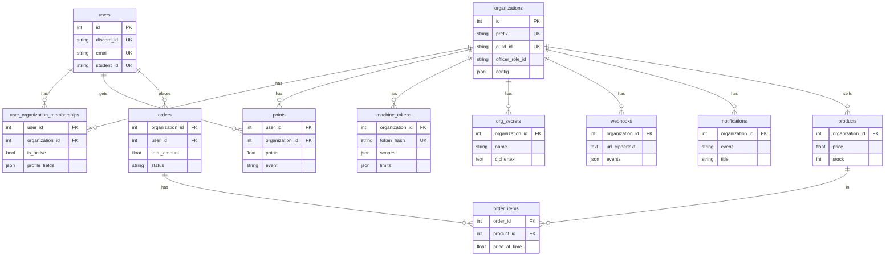

# Data model

This page lists each table, the module that owns it, and the rules to change the schema. The models are SQLAlchemy classes that use `Base` from `core/db/base.py`. `modules/manifest.py` lists every model module.

## The core tables

- `organizations`: one row for each org, which is one Discord server. `prefix` is the URL name and `guild_id` is the server id. `officer_role_id` is the Discord role that makes a member an officer. If it is empty, the org has no officers. `config` is a JSON object with the module switches, branding and module settings.
- `users`: one row for each person, for all orgs. `discord_id`, `username`, `email`, `student_id` and `uuid` are each unique and can be empty. A lookup can thus try more than one of them.
- `user_organization_memberships`: the link between a member and an org, with `is_active` and the org's own `profile_fields`. A member must have an active membership to get points or to buy in the store.
- `points`: a ledger with one row for each change. The balance is `SUM(points)` for a member and an org. A purchase adds a negative row.

Rows that belong to an org have an `organization_id` column. Discord roles decide who is an officer, not a table. A role change in Discord thus changes access at the next request (the cache keeps the result for 60 seconds).

This diagram shows the core tables and some module tables, with their main columns.



## All tables

| Module | Tables |
| --- | --- |
| core | `audit_log` (successful changes and job runs), `error_groups` (errors of each process and the dashboard, grouped), `org_secrets` (org secrets, encrypted with `SECRETS_KEY`), `webhooks` (outbound webhooks of each org and their events), `notifications` (each webhook event of an org, shown in Notifications), `org_limits` (the superadmin's limit overrides for each org), `deployment_secrets` (secrets of the deployment, such as a shared app's admin token), `usage_counters` (what each org used of a rate limit in each window) |
| organizations | `organizations`, `organization_configs` and `officers` (not used) |
| users | `users`, `user_organization_memberships` |
| points | `points` |
| storefront | `products` (price in points), `orders`, `order_items` (keeps the price at the time of the order) |
| auth | `refresh_tokens` (hash only), `revoked_tokens`, `app_tokens`, `machine_tokens` (hash only, scopes, and per-integration `limits`), `sessions` (not used) |
| calendar | `calendar_event_links` (not used by the sync, which uses Google event properties) |
| games | `jeopardy_game`, `active_game` (one active game for the deployment) |
| leetcode | `leetcode_link`, `leetcode_solve` (one solve for each member and day), `leetcode_daily` |
| accounts | `account_grants`, `account_logins` |
| agents | `agent_conversations`, `agent_messages`, `agent_memories`, `agent_profile_nodes`, `agent_profile_edges`, `agent_pending_actions` |
| knowledge | `knowledge_sources`, `knowledge_versions`, `knowledge_chunks`, `knowledge_runs` (one row for each crawl or upload). A source and its chunks belong to an org, or with no org to a shared submodule (`submodule_id`) |
| submodules | `submodules` (one row for each submodule), `submodule_subscriptions` (the orgs that subscribe to each) |
| godfather | `compute_pods`, `compute_keys`, `compute_sessions`, `compute_connections` (one row for each pod certificate, kept 90 days) |
| runpod | `runpod_apps` (with no org for a shared app), `runpod_deployments`, `shared_app_subscriptions` (the orgs that use a shared app, and whom Platform invited) |
| feeds | `alert_feeds`, `alert_posts`, `alert_runs` (one row for each feed run) |
| mcp | `oauth_clients` (MCP clients that registered themselves, secret encrypted with `SECRETS_KEY`, and cached Client ID Metadata Documents with `cache_until`), `oauth_requests` (open OAuth requests and codes, hash only, with the scopes and limits that the officer chose), `oauth_grants` (approved connections: the machine token of kind `oauth`, the refresh token hash, and the last officer check), `oauth_assertions` (the `jti` hash of each used client assertion, until it expires) |
| superadmin | `server_service_owners` (the owner of each container or host process that the host agent lists) |
| uptime | `uptime_monitors`, `uptime_checks` (one row for each check, kept `UPTIME_RETENTION_DAYS`, default 30) |
| jobs | `procrastinate_*` (Postgres only, from the Procrastinate SQL, not from models) |

The `godfather` tables keep the `compute_` names of the module's old name. The `feeds` tables keep the `alert_` names.

`compute_pods` and `runpod_apps` have a `provider` column: the name of the hosting provider in `core/hosting.py`. Migration `dde330bf1668` added it with the default `runpod`, so existing rows stay on RunPod.

`audit_log` has one row for each successful POST, PUT, PATCH or DELETE under `/api`, and one row for each job run. It keeps the route, org, caller, status and path. It never keeps request bodies or file contents. The `audit.prune` job removes rows older than `AUDIT_RETENTION_DAYS` (default 365).

`error_groups` has one row for each distinct error. Errors with the same source, org, exception type and first frame in this repo add to one row: `count` goes up and `last_seen`, `message` and `stack` change. A resolved row opens again when its error happens again. The `error_log.prune` job removes rows not seen for `ERROR_RETENTION_DAYS` (default 90).

`webhooks` has one row for each outbound webhook of an org: a name, a kind (`discord`), the URL encrypted with `SECRETS_KEY` in `url_ciphertext`, a `url_hint` with no token in it, and the list of event keys it sends. `last_sent_at` and `last_error` keep the result of the last message. Migration `a1358e0da9ef` moved each org secret `error_webhook_url` to a webhook named Errors.

`notifications` has one row for each webhook event of an org, whether or not a webhook takes it: the event key, title, text and color. Saving a new row removes the org's rows older than 30 days and keeps at most the newest 200.

## Migrations

Alembic owns the schema on SQLite and Postgres. Nothing creates tables when the app starts. The API container runs `alembic upgrade head` before gunicorn. The tests make their schema with `create_all`.

```bash
uv run alembic upgrade head                            # apply migrations (make migrate)
uv run alembic revision --autogenerate -m "Add x"      # make a migration after a model change
uv run alembic check                                   # fail if the models and migrations do not agree
uv run alembic downgrade -1                            # go back one migration
```

- `make ci` runs `alembic upgrade head` and `alembic check` on a new database. If you change a model and do not add a migration, CI fails.
- `alembic/env.py` uses `render_as_batch=True`, because SQLite cannot alter a column. Alembic copies the table to make the change.
- `DATABASE_URL` overrides the URL in `alembic.ini`.
- `alembic/env.py` ignores the `procrastinate_*` tables and the indexes that migrations make with raw SQL (pgvector HNSW and full text GIN).

The `migration` skill in `.agents/skills/` has the full procedure.
