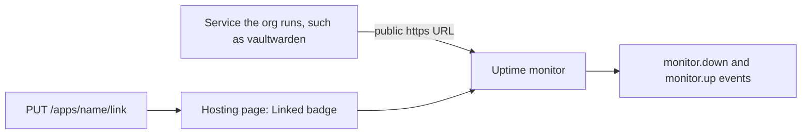
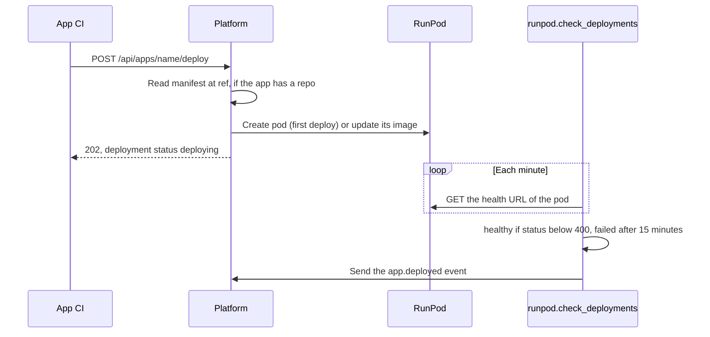

# RunPod apps

Deploys an org's own apps (a Discord bot, an agent, a model server) to pods on a hosting provider. RunPod is the only provider, and the manifest follows the RunPod v2 pod API. An officer registers the app's manifest one time. Then the app's CI deploys each new image tag with a token that can do nothing else. Each org deploys with its own RunPod key and pays for its own pods.

## Setup

Officers can do steps 1, 2 and 4 on the dashboard (Settings > Secrets, and the Services tab of the Hosting page). The Services tab also deploys, rolls back and deletes.

1. Connect RunPod on the Integrations tab of the dashboard Explore page. This saves the org secret `runpod_api_key`.
2. Save each secret env value of the app as an org secret with a name that starts with `app_`.
3. Make a machine token with only `apps:deploy` for the app's CI. A script that manages apps needs `apps:read` and `apps:manage`.
4. Register the app in one of two ways:
   - From its repo: `PUT /api/apps/<name>` with `{"repo": "owner/name"}`, and `manifest_path` if the file is not `platform.app.yaml` at the root. Platform reads the file from the default branch now, and again at the `ref` of each deploy. A private repo needs the org secret `github_token` with read access to the repo contents.
   - Inline: `PUT /api/apps/<name>` with `{"manifest": {...}}`.
   - Both forms take an optional `provider`, the name of a hosting provider. The default is `runpod`. An app that has a pod keeps its provider; a change answers 409.

With a repo, a change to the pod's env, ports or disk is a pull request to the app, with the same review as its code. A person who can merge to the app's repo can already change what runs on the pod. Thus the deploy token gets no more access.

## Linked apps

A linked app is a service that the org runs outside Platform, such as a container that was on the server before Platform. Platform lists it on the Hosting page and Uptime checks its URL, so its down and up events reach the org's webhooks. Platform does not deploy it, roll it back or stop it, and it counts against no limit.



- Link one on the Hosting page with **Link service**, with `PUT /api/apps/<name>/link` (`apps:manage`), with the `apps.link` tool, or on the server:

  ```bash
  flask --app main apps link soda vault --url https://vault.thesoda.io --kind service --runs-as vaultwarden
  ```

- The body is `{"url": "https://...", "kind": "site|service|bot|agent|database", "description": "...", "runs_as": ["container or process"]}`. `url` is optional; with no URL, Uptime has nothing to check. `runs_as` is for people to read.
- Link it again to change it. Delete it to unlink it; the service keeps running.
- Deploy, rollback and `PUT /<name>` answer 409 for a linked app, and linking a name that a deployed app has answers 409.
- The org needs the `runpod` module on to see the Hosting page, and `uptime` on for the monitor.

## Templates

`apps/` holds ready-made apps: [Vaultwarden](../../apps/vaultwarden/README.md) and [Hermes Agent](../../apps/hermes/README.md). See [apps/README.md](../../apps/README.md) for the template format.

1. On the Services tab of the Hosting page, select **Templates** and pick a template.
2. Fill in the name and the inputs, then select **Create app**. Secret inputs become org secrets named `app_<name>_<input>`. The app gets an inline manifest.
3. Deploy a tag. The deploy form shows the template's tag, if it has one.

## Manifest

`platform.app.yaml` has the same fields as the inline JSON:

```json
{
  "kind": "bot",
  "description": "The club Discord bot",
  "image": "ghcr.io/example-club/club-bot",
  "gpu": {"id": "NVIDIA RTX A5000", "count": 1},
  "cloud": "SECURE",
  "disk": 50,
  "ports": ["8080/http"],
  "env": {"MODE": "prod"},
  "secret_env": {"DISCORD_TOKEN": "app_club_bot_discord_token"},
  "mounts": {"network": [{"volumeId": "vol_xyz", "path": "/runpod-volume"}]},
  "health": {"port": 8080, "path": "/health"}
}
```

- `kind` is `bot`, `agent`, `site` or `service` (the default). `description` (200 characters or fewer) and `url` (https, the app's public address) are optional. The dashboard groups apps by `kind` and shows the other two. Deploys do not send these three fields to RunPod. App responses include `kind`, `description`, `url`, `provider` and `host`. `host` is the same as `provider` and stays for older clients.
- `image` has no tag. The deploy gives the tag. Use `gpu` or `cpu` (`{"id": "cpu5c", "vcpuCount": 4}`), not both.
- `gpu`, `cpu`, `cloud`, `dataCenterIds` and `mounts` apply when the pod is created. To change them, terminate the pod in RunPod, then `DELETE` and `PUT` the app again.
- `env`, `disk`, `ports`, `args` and `registry` go with each deploy.
- `secret_env` maps a pod env var to an org secret. The deploy reads the values. The API never returns them, and a dry run shows `(secret)`. RunPod shows pod env in its console, so a person with access to the org's RunPod account can read them.
- Platform checks `health` at `https://<pod>-<port>.proxy.runpod.net<path>`. The port must be in `ports` as `/http`.

## Routes

All routes are under `/api/apps`. They need a machine token, and the org is the org of the token.

| Route | Scope | Does |
| --- | --- | --- |
| `GET /` | `apps:read` | Apps with pod id, current tag and latest deployment |
| `GET /templates` | `apps:read` | App templates from `apps/`, with their inputs and manifests |
| `POST /templates/<template>` | `apps:manage` | `{"name": "vault", "values": {...}, "secrets": {...}, "provider": "runpod"}`. Saves the secrets, then registers the app inline. 201. 409 if the app exists. A secret the org already saved can be left out |
| `GET /<name>` | `apps:read` | One app and its manifest |
| `PUT /<name>` | `apps:manage` | Creates or replaces the manifest. The name `templates` is not available |
| `PUT /<name>/link` | `apps:manage` | Adds or updates a linked app (see Linked apps) |
| `DELETE /<name>` | `apps:manage` | Removes the app record. The pod continues to run |
| `GET /<name>/deployments` | `apps:read` | The latest 20 deployments |
| `GET /<name>/pod` | `apps:read` | The pod as its provider shows it |
| `POST /<name>/deploy` | `apps:deploy` | `{"tag": "v1.2.0" or "sha256:...", "ref": "<git sha>", "dry_run": false}`. `ref` is only for apps with a repo; without it, Platform reads the default branch. A dry run returns the manifest and the RunPod request. 202 when the deploy starts |
| `POST /<name>/rollback` | `apps:manage` | Deploys the newest healthy tag that is not the current tag, with the manifest of that deploy |

The `apps.list` tool returns the same list as `GET /`.

The first deploy creates the pod, named `<org>-<app>`. A later deploy changes its image, which restarts it: the container disk is erased and volumes stay. A new deploy replaces one that is still in progress. The `runpod.check_deployments` job runs each minute. It marks a deployment healthy when its health path returns a status below 400, or failed after 15 minutes. There is no automatic rollback. The Uptime module checks the app: a new app gets a monitor when it is registered and Uptime is on, and a deleted app loses its monitors.



## Deploy from GitHub Actions

Add this step after the image push. For an app with an inline manifest, remove `ref`.

```yaml
- name: Deploy to RunPod
  run: |
    curl -fsS -X POST "$PLATFORM_URL/api/apps/club-bot/deploy" \
      -H "Authorization: Bearer $DEPLOY_TOKEN" -H "Content-Type: application/json" \
      -d "{\"tag\": \"${GITHUB_SHA}\", \"ref\": \"${GITHUB_SHA}\"}"
  env:
    PLATFORM_URL: ${{ vars.PLATFORM_URL }}
    DEPLOY_TOKEN: ${{ secrets.PLATFORM_DEPLOY_TOKEN }}
```
