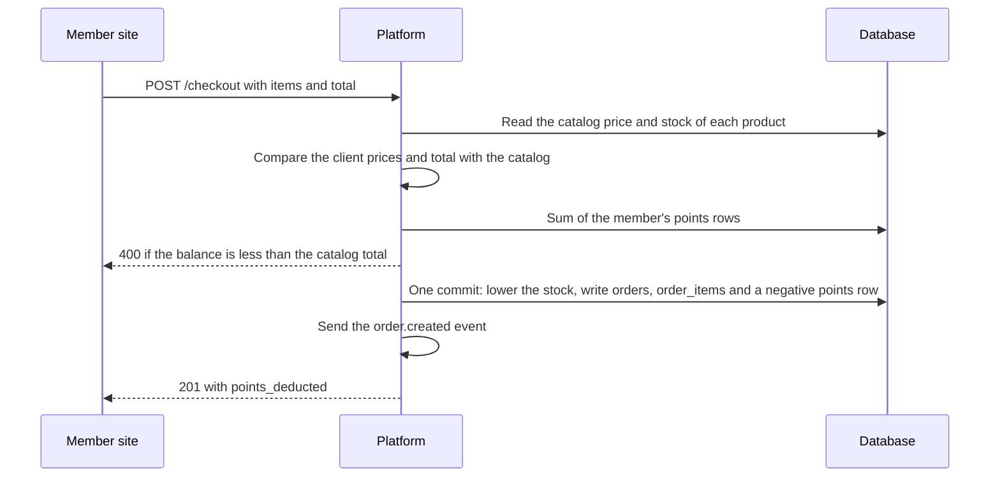

# Store

A merch store that members pay for with points. Officers add products and manage orders. Members buy with their points balance. The `storefront` switch turns the module on and off.

## In the dashboard

The Store page (Storage > Store) has two tabs:

- **Products**: name, price in points, stock, category and image. Add, edit and delete products.
- **Orders**: each order with the member, the items and the total. Change the status: pending, processing, shipped, delivered or cancelled.

A product that is in an order cannot be deleted. Set its stock to 0 to remove it from the store.

## How a purchase works

1. A member opens the store and picks products.
2. Platform reads the prices from the catalog. The charge is the sum of each catalog price times its quantity. It does not use prices or a total that the client sends.
3. Platform checks that the member has enough points and that each product has stock.
4. Platform writes the order, lowers the stock and writes a negative points row for the charge in one commit. If one write fails, none of them stays.

The member site checkout, `POST /checkout`, does these steps.

The request must have a `total_amount` greater than 0, or the route returns 400. If the client total or a client price is not the catalog price, Platform logs `checkout_price_mismatch`. If `ACCESS_ENFORCE` is true, the route also returns 409.

`POST /members/orders` writes a pending order at the catalog total with no points row.

## Cancel and delete

| Change | Stock | Points |
| --- | --- | --- |
| Status changes to cancelled | Items go back in stock | A `Refund - Order #<id>` row gives back the points of the order |
| Delete an order that is not cancelled or delivered | Items go back in stock | The same refund |
| Delete a cancelled or delivered order | No change | No change |

A refund gives back only what the `Storefront Purchase - Order #<id>` row took, less earlier refunds. An order with no purchase row gets no refund. A cancelled order cannot change to another status; the route returns 409.

## Routes

All routes are under `/api/storefront/<org>`.

| Route | Who | Does |
| --- | --- | --- |
| `GET /products`, `GET /products/<id>`, `GET /store` | Everyone | The catalog |
| `POST /products`, `PUT /products/<id>`, `DELETE /products/<id>` | Officers | Changes the catalog |
| `GET /orders`, `GET /orders/<id>` | Officers | Orders of the org |
| `PUT /orders/<id>`, `DELETE /orders/<id>` | Officers | Changes the status; deletes an order. Both can give a refund |
| `GET /members/store`, `GET /members/points` | Members (Discord) | The store and the member's balance |
| `GET /members/orders`, `POST /members/orders`, `GET /members/orders/<id>` | Members (Discord) | The member's orders; places an order; one of the member's orders |
| `POST /checkout`, `GET /wallet/<email>`, `GET /orders/<email>` | Member site token | The same for the member site |

## Limits

- A new product needs stock of 1 or more.
- Checkout reads the balance and writes the order with no row lock. Two orders at the same time can spend the same points.

## Tables

`products`, `orders`, `order_items`.
