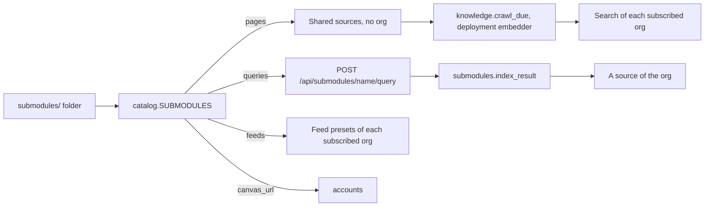

# Submodules

A submodule is a domain, such as one campus or careers, that an org subscribes to. Each module that reads the submodule gets its part: public pages for [knowledge](./knowledge.md), live queries for agents, feeds for the [webhook modules](./feeds.md), and the school's Canvas URL for [accounts](./accounts.md). Submodules are folders in [`submodules/`](../../submodules/README.md) of the repo. A submodule holds content and settings, not new behavior. Features are [modules](../writing-a-module.md).

The deployment crawls and embeds a submodule's pages once, for every org that subscribes. The pages are the submodule's own sources: they have no org, and they count against no org's limits.

| Submodule | Content |
| --- | --- |
| [asu](../../submodules/asu/README.md) | Arizona State University: library hours, events, courses, dining, scholarships, news, shuttles, jobs, sports; the ASU Canvas URL; the ASU sign-in for Sun Devil Central ([Sign in to ASU](../integrations.md#sign-in-to-asu)) |
| [careers](../../submodules/careers/__init__.py) | Feeds for software internships and new grad roles (`job_webhook`) and for hackathons (`hackathon_webhook`) |

## Subscribe an org

1. On the Explore page of the dashboard, open the Submodules tab.
2. Click **Subscribe** next to the submodule.

A subscription does these things:

- Knowledge search of the org reads the submodule's pages. If the submodule has no shared pages yet, the subscription makes them, and the crawl job gets them.
- The feeds of the submodule show under **Start from** on the Job alerts webhook and Hackathon webhook pages. A feed needs its module on and a Discord webhook URL.

**Unsubscribe** stops both. Feeds that the org already made keep running. The shared pages stay for the other subscribers, and the crawl job skips a submodule that no org subscribes to.

When Platform is updated, the next subscription brings the shared pages up to date: new URLs, categories and schedules, and pages that are no longer in the submodule turned off.

Each org can have `submodules.subscriptions` subscriptions, 20 by default ([Limits](../limits.md)).

## Routes and tools

| Route | Caller | Does |
| --- | --- | --- |
| `GET /api/dashboard/<org>/submodules` | Officer | Each submodule: its pages, queries and feeds, the modules that read it, the shared pages and last crawl, whether the org subscribes, and how many orgs do |
| `PUT`, `DELETE /api/dashboard/<org>/submodules/<submodule>/subscription` | Officer | Subscribes, or ends the subscription |
| `GET /api/superadmin/submodules` | Superadmin | Each submodule's subscribers, shared pages, passages and failing pages |
| `GET /api/submodules` | Token, `knowledge:read` | The same list as the dashboard |
| `PUT`, `DELETE /api/submodules/<submodule>/subscription` | Token, `submodules:manage` | Subscribes, or ends the subscription |
| `GET /api/submodules/<submodule>/queries` | Token, `knowledge:read` | The live queries and their parameters, with descriptions and allowed values |
| `POST /api/submodules/<submodule>/query` | Token, `knowledge:read` | `{"source": "courses", "params": {"term": "Fall 2026"}}` returns `submodule`, `source`, `url` and `text` |

The older `POST /api/submodules/<submodule>/sync`, `POST /api/dashboard/<org>/knowledge/submodules/<submodule>/sync` and `/api/asu/*` routes still answer. A sync subscribes.

Tools: `submodules.list` (`submodules:read`), `submodules.subscribe` and `submodules.unsubscribe` (`submodules:manage`, confirm), and `submodules.query` (`knowledge:read`). `knowledge.submodules` and `knowledge.sync_submodule` do the same as `submodules.list` and `submodules.subscribe`.

Platform checks the parameters of a live query before it gets a page. An unknown submodule or query returns 404. A bad parameter returns 422 with the values the query accepts. A failed fetch returns 502. After the answer, the `submodules.index_result` job adds the result to the org's knowledge as its own `<submodule>-live/<query>-<hash>` source. It never writes into a shared page, and it does not write a result that did not change. A query with `index=False`, such as `web`, is not indexed.

## How the shared pages are crawled

- **Fetch:** the deployment's Firecrawl (`FIRECRAWL_URL`), not an org's.
- **Passages:** the deployment's chunk settings (`KNOWLEDGE_CHUNK_CHARS`), not an org's.
- **Vectors:** the deployment's embedder (`EMBEDDINGS_URL`). Vector search reads only passages of the org's own model, so an org with its own embedding model finds the shared pages by text search.
- **Runs:** a crawl of a shared page is not in an org's run log. Its last error stays on the page and shows on the Superadmin page.

## Settings

An org sets its own Firecrawl and SearXNG on the Integrations tab of the dashboard Explore page ([integrations](../integrations.md)). Live queries use them. The variables below are the deployment defaults, and the shared pages use them.

| Variable | Default | Does |
| --- | --- | --- |
| `FIRECRAWL_URL` | not set | Renders JavaScript pages. If it is not set, those pages are almost empty |
| `SEARXNG_URL` | not set | The search service for the `web` query. If it is not set, that query returns 503 |
| `SEARXNG_ENGINES` | `google,brave,bing` | The engines SearXNG asks |
| `PACK_QUERY_MAX_CHARS` | 30000 | The maximum text length of a live query result. `ASU_QUERY_MAX_CHARS` still works |

## Write a submodule

See [submodules/README.md](../../submodules/README.md).
