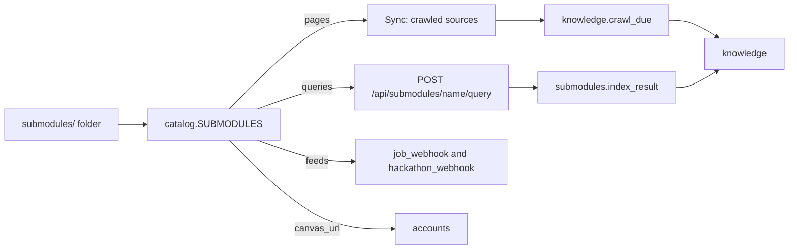

# Sub-modules

A sub-module is content that a module reads, for one campus or topic. It can hold public pages that Platform crawls into an org's [knowledge](./knowledge.md), live queries that agents run, feeds for the [webhook modules](./feeds.md), and the school's Canvas URL for [accounts](./accounts.md). Sub-modules are folders in [`submodules/`](../../submodules/README.md) of the repo. A sub-module holds content and settings, not new behavior. It adds no tables, routes or dashboard pages, so any org can write one. Features are [modules](../writing-a-module.md).

| Sub-module | Content |
| --- | --- |
| [asu](../../submodules/asu/README.md) | Arizona State University: library hours, events, courses, dining, scholarships, news, shuttles, jobs, sports; the ASU Canvas URL; the ASU sign-in for Sun Devil Central ([Sign in to ASU](../integrations.md#sign-in-to-asu)) |
| [careers](../../submodules/careers/__init__.py) | Feeds for software internships and new grad roles (`job_webhook`) and for hackathons (`hackathon_webhook`) |

## Add a sub-module to an org

Feeds: on the Job alerts webhook or Hackathon webhook page, click **New feed** and pick the feed under **Start from**. Add a Discord webhook URL and create the feed. The module must be on.

Pages: on the Explore page of the dashboard, find the Knowledge card and click **Add** next to the sub-module. The `knowledge` module must be on. Click **Sync** after Platform is updated to get new pages.

Sync adds each page of the sub-module as a crawled source of the org, with a key that starts with `<submodule>/`. When you sync again, it updates URLs, categories and schedules, and turns off the `<submodule>/` sources that are no longer in the sub-module. The crawl job then gets the pages. If the org is a knowledge publisher, the sources are public. If not, they are private.

## Routes and tools

Machine tokens only. The org is the token's org.

| Route | Scope | Does |
| --- | --- | --- |
| `GET /api/submodules` | `knowledge:read` | Each sub-module, its pages, queries and feeds, and the number of the org's sources it owns |
| `GET /api/submodules/<submodule>/queries` | `knowledge:read` | The live queries and their parameters, with descriptions and allowed values |
| `POST /api/submodules/<submodule>/query` | `knowledge:read` | `{"source": "courses", "params": {"term": "Fall 2026"}}` returns `submodule`, `source`, `url` and `text` |
| `POST /api/submodules/<submodule>/sync` | `knowledge:write` | Adds or updates the sub-module's pages as crawled sources |

`/api/asu/queries`, `/api/asu/query` and `/api/asu/sync` are the routes of the old asu module. They run the same calls for the `asu` sub-module.

Tools: `submodules.query` (`submodule`, `source`, `params`), `knowledge.submodules` and `knowledge.sync_submodule`. Officers use `GET /api/dashboard/<org>/knowledge/submodules` and `POST /api/dashboard/<org>/knowledge/submodules/<submodule>/sync`.

Platform checks the parameters before it gets a page. An unknown sub-module or query returns 404. A bad parameter returns 422 with the values the query accepts. A failed fetch returns 502. After the answer, the `submodules.index_result` job adds the result to knowledge. It uses the sub-module's source with the same URL if there is one, else its own `<submodule>-live/<query>-<hash>` source. It does not write a result that did not change. A query with `index=False`, such as `web`, is not indexed.

## Settings

An org sets its own Firecrawl and SearXNG on the Integrations tab of the dashboard Explore page ([integrations](../integrations.md)). The variables below are the deployment defaults.

| Variable | Default | Does |
| --- | --- | --- |
| `FIRECRAWL_URL` | not set | Renders JavaScript pages. If it is not set, those pages are almost empty |
| `SEARXNG_URL` | not set | The search service for the `web` query. If it is not set, that query returns 503 |
| `SEARXNG_ENGINES` | `google,brave,bing` | The engines SearXNG asks |
| `SUBMODULE_QUERY_MAX_CHARS` | 30000 | The maximum text length of a live query result. `ASU_QUERY_MAX_CHARS` still works |

## Write a sub-module

See [submodules/README.md](../../submodules/README.md).
