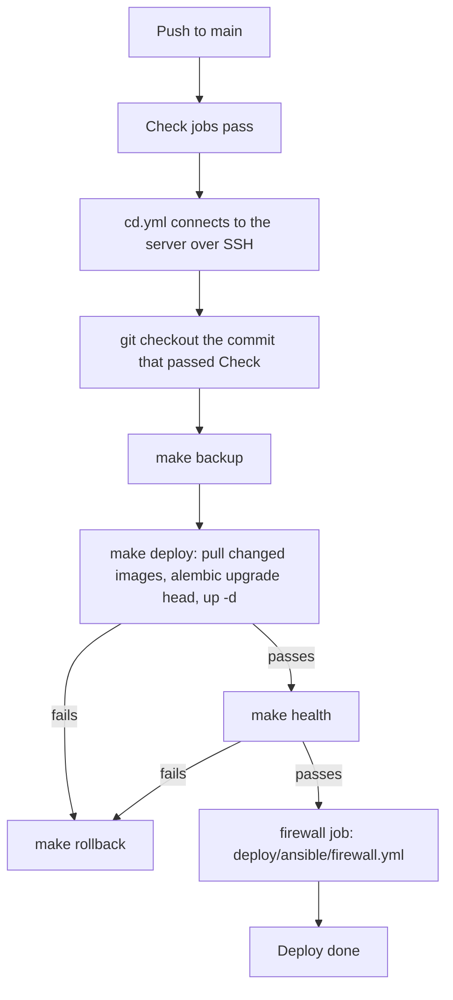

# Operations

This page tells you how to deploy Platform, roll it back, move it to Postgres, run org apps on the server, and turn off routes. To run Platform on one RunPod pod, see [Getting started](./getting-started.md).

## Compose services

`docker-compose.yml` defines these services. Each one restarts unless stopped and keeps 3 log files of 10 MB.

| Service | Command | Profile |
| --- | --- | --- |
| `api` | `alembic upgrade head`, then gunicorn with 1 worker and 8 threads on `127.0.0.1:8000` | default |
| `bot` | `python3 bot_main.py`. Run exactly one, or each scheduled post goes out more than once | default |
| `dashboard` | The dashboard build (`Dockerfile.dashboard`) on port 5001, for admin.thesoda.io | default |
| `postgres` | Postgres 16 with pgvector | `postgres` |
| `worker` | `python3 worker_main.py` | `postgres` |
| `mcp` | `python3 mcp_main.py` on `127.0.0.1:8001`, reached at `<API URL>/mcp` | `mcp` |
| `site` | The landing and docs site (`Dockerfile.site`, Next.js) on `127.0.0.1:3010`, for platform.thesoda.io | `site` |

The `api` and `mcp` ports bind only `127.0.0.1`, so a client reaches them only through the reverse proxy and its TLS. Nginx Proxy Manager forwards the API host to `127.0.0.1:8000` and its `/mcp` location to `127.0.0.1:8001`.

The API mounts `./data` (SQLite database and JWT keys), `./.env` and `./google-secret.json`.

Caution: make sure that `google-secret.json` is on the host, also if it is empty. If it is not there, the API container does not start.

The API uses one gunicorn worker because the one-time sign-in codes are in process memory. Increase `--workers` only after those codes move to the database.

## Container limits

Each container has a memory and a CPU cap, so one process cannot take the whole server. The values come from `.env`, with these defaults:

| Service | Memory | CPUs | Settings |
| --- | --- | --- | --- |
| `api` | 1536m | 1.5 | `API_MEM_LIMIT`, `API_CPUS` |
| `bot` | 768m | 1 | `BOT_MEM_LIMIT`, `BOT_CPUS` |
| `worker` | 1536m | 1 | `WORKER_MEM_LIMIT`, `WORKER_CPUS` |
| `mcp` | 768m | 1 | `MCP_MEM_LIMIT`, `MCP_CPUS` |
| `dashboard` | 256m | 0.5 | `DASHBOARD_MEM_LIMIT`, `DASHBOARD_CPUS` |
| `site` | 384m | 0.5 | `SITE_MEM_LIMIT`, `SITE_CPUS` |
| `postgres` | 1g | 1 | `POSTGRES_MEM_LIMIT`, `POSTGRES_CPUS` |

A container that goes over its memory cap is stopped and starts again (`restart: unless-stopped`). A new value applies when the container is made again, for example at the next deploy. The Superadmin page shows the memory use and cap of the API container, and with the [host agent](#host-agent) of every container. These caps are for each service, not each org: [Limits](./limits.md) caps what each org uses.

## Host agent

The host agent lists each container and host process on the server for the Services card on the Superadmin page. It runs on the host as root, because only root sees every container. It only reads: `podman ps`, `podman stats`, the proxy hosts of Nginx Proxy Manager (opened read-only), the listening ports, and the cgroups of host processes. Every 30 seconds it writes `data/host.json`, which the API reads as `/app/data/host.json`. The API has no access to the podman socket.

1. Copy the unit: `cp deploy/host-agent/platform-host-agent.service /etc/systemd/system/`.
2. Add one `--port` to `ExecStart` for each host process that no proxy host forwards to.
3. Start it: `systemctl daemon-reload && systemctl enable --now platform-host-agent`.

A container started by `docker-compose.yml` is Platform's. A container with the label `platform.org=<prefix>` is that org's. The superadmin sets the owner of each other service on the Services card (`PUT /api/superadmin/server/services/<name>`). If the file is older than 2 minutes, the card shows "Agent stopped".

## This server runner

The runner lets orgs deploy apps to this server (provider `server` on the Hosting page). It runs on the host as root, because podman runs the server's containers as root. The API reaches it over the Unix socket `data/runner.sock`, which only uid 1000 (Platform's containers) can open. The runner checks each request against `/etc/platform-runner.json` and refuses the rest, so the API cannot start a container that the policy does not allow.

| Policy key | Means |
| --- | --- |
| `socket`, `socket_gid` | The socket path and the group that may use it (1000, the containers' user) |
| `data_root` | The folder that holds each app's named volumes: `<data_root>/<org>/<app>/<name>` |
| `bind_ips` | The addresses a published port binds to. Keep them private: `127.0.0.1` and the podman gateway `10.88.0.1`, where Nginx Proxy Manager reaches it |
| `registries` | The image prefixes allowed, such as `ghcr.io/` |
| `memory_mb_total`, `memory_mb_max`, `cpus_max` | The memory of all app containers together, and the caps of one container |
| `port_range` | The host ports any org may publish |
| `orgs.<prefix>.host_paths`, `orgs.<prefix>.host_ports` | Host paths and host ports that only this org may use, for services it ran on the server before |
| `orgs.<prefix>.no_new_privileges_off` | Apps of the org that run without `no-new-privileges`: Postgres and Redis images drop to their own user with `gosu`, which that option stops on this server. Only list databases |
| `bridge_image` | The image of `platform-bridge`, a small container that the runner keeps on podman's default network so that the bridge address `10.88.0.1` stays in place |
| `orgs.<prefix>.public_ports` | Host ports of the org that bind every address, not only `bind_ips`, for a service that clients reach by the server's IP. Keep it short |
| `shared.host_paths`, `shared.host_ports` | Host paths and host ports that only shared apps may use |
| `host_control.containers`, `host_control.units` | The other containers and systemd units that the superadmin may start, stop, restart and read the logs of on the Services card. Container names may use `*`, such as `twenty_*`; units are exact names. App containers are controlled through their apps |

1. Copy `deploy/runner/platform-runner.example.json` to `/etc/platform-runner.json` and edit it. Make it `root:root`, mode 600.
2. Copy `deploy/runner/platform-runner.service` to `/etc/systemd/system/`.
3. Start it: `systemctl daemon-reload && systemctl enable --now platform-runner`.

The unit has `KillMode=process`, so a restart of the runner, for example after a policy change, does not stop the app containers.

The Hosting page then lists This server as a provider. An app container is named `app-<org>-<app>` and has the labels `platform.managed=1`, `platform.org` and `platform.app`, so the [host agent](#host-agent) gives it to its org.

The `shared` key of the policy has `host_paths` and `host_ports` too: the ones that shared apps (no org) may use, such as the vault's folder and port. No org may use them.

### Move a service that already runs on the server

1. Add the service's host paths and host port to the org in `/etc/platform-runner.json`, and restart the runner.
2. Register the app with `provider: server` and a manifest with the same image, env, `publish` and `volumes` as the old container.
3. Stop the old container (for a systemd unit, `systemctl disable --now <unit>`), then deploy the same tag at once. The domain does not change, because the new container takes the same host port. The service is down for a few seconds.
4. To go back, delete the app and start the old container or unit again.

Caution: a database needs two more steps, or it does not start or its data can be damaged.

- Add the app to the org's `no_new_privileges_off` in the policy. Postgres and Redis images drop to their own user with `gosu`, and `no-new-privileges` stops that, so the container hangs.
- Save the old container's settings (`podman inspect` to a root-only file), stop it, make a cold copy of its data folder, then remove it. Renaming it is not enough: its restart policy would start it again after a reboot, on the same data folder as the new container. This podman cannot change a container's restart policy.

## Firewall

`deploy/ansible/firewall.yml` sets up ufw on the SoDA server. The `firewall` job of `cd.yml` runs it after each deploy that passes. From the internet, the server then accepts only these connections:

| Port | From |
| --- | --- |
| The SSH port (`VPS_SSH_PORT`) and each `Port` in the sshd config | Every address |
| 80 and 443 | Cloudflare only (`deploy/ansible/group_vars/all/cloudflare.yml`) |

ufw drops all other incoming connections, also to 81 (the Nginx Proxy Manager admin page). Connections from the host and from containers do not change. Nginx Proxy Manager runs on the host network, so it still reaches `127.0.0.1:8000`, `127.0.0.1:8001` and `10.88.0.1:5001`. Containers on a podman network still get DNS from aardvark-dns. A container also still reaches a published port on `10.88.0.1`, such as the Uptime check of an app on This server, because podman sends that connection to the app container. ufw drops a connection from a container to a host process that is not in a container.

Podman sends traffic for a published host port to the container (DNAT) before ufw's input rules see it. ufw alone does not close 5001, which `docker-compose.yml` publishes on every address. The playbook writes `/etc/ufw/before.init`, which ufw runs when it starts and stops. It drops new connections to the ports in `firewall_published_ports_blocked` (default `5001/tcp`) that come in on a public interface. An org's `public_ports` in the runner policy stay open, because the playbook does not add them.

The playbook does these steps:

1. Compare the Cloudflare ranges with https://www.cloudflare.com/ips-v4 and https://www.cloudflare.com/ips-v6. If they are different, stop before a change.
2. Add the rules, with the comments `platform-ssh`, `platform-cloudflare` and `platform-podman-dns`. Remove the rules with these comments that are not in the lists. Do not remove other rules. The job output lists them.
3. If ufw is off, start a systemd timer (`platform-firewall-revert`) that runs `ufw --force disable` after 600 seconds. Then start ufw.
4. Open a new SSH connection, and get each URL in `firewall_health_urls` through Cloudflare. If this passes, stop the timer. If it fails, turn ufw off again. If the server cannot be reached, the timer turns ufw off.
5. From the GitHub runner, make sure that each port in `firewall_closed_ports` does not accept a connection. If one does, the job fails and ufw stays on.

Caution: a proxy host in Nginx Proxy Manager that Cloudflare does not proxy (a DNS-only record) stops working. Turn on the Cloudflare proxy for each such host before the first run.

When Cloudflare changes its ranges, the `firewall` job fails at step 1 and shows the changes. Do these steps:

1. Update `deploy/ansible/group_vars/all/cloudflare.yml`.
2. Update the real IP config of Nginx Proxy Manager (`set_real_ip_from`), or app logs and the per-IP limits of the MCP server get Cloudflare's addresses.
3. Push to `main`. The next deploy removes the old ranges and adds the new ones.

To open the Nginx Proxy Manager admin page, use an SSH tunnel: `ssh -L 8181:127.0.0.1:81 <user>@<server>`, then open http://localhost:8181.

To run the playbook from your machine, with no change first (`--check`):

```bash
cd deploy/ansible
VPS_HOST=<server> VPS_USERNAME=root VPS_SSH_PORT=22 uv run --only-group deploy ansible-playbook firewall.yml --check --diff
```

`inventory.yml` reads `VPS_HOST`, `VPS_USERNAME`, `VPS_SSH_PORT` and `VPS_SSH_PASSWORD` from the environment, and has the URLs and ports of the SoDA server. `group_vars/all/firewall.yml` has the defaults. The user must be root or have sudo with no password.

## Images and CI

| Workflow | Does |
| --- | --- |
| `check.yml` | On each push and PR: `make ci` and bandit; migrations and tests on Postgres 16; the dashboard and site builds; the images (`images.yml`); workflow lint. A push to `main` in `asusoda/platform` then runs `cd.yml` |
| `images.yml` | `check.yml` calls it. Builds the API, dashboard and site images. On `main` it pushes them to GHCR as `ghcr.io/<owner>/<repo>-api`, `-dashboard` and `-site`, tagged with the commit sha and `main`. The build cache is the `buildcache` tag of each image |
| `cd.yml` | Deploys the example SoDA server for the commit that passed Check. `check.yml` calls it only in `asusoda/platform`. Each run is a deployment to the `production` environment on the repository's Deployments page. After the deploy, its `firewall` job runs the [firewall playbook](#firewall) |

The Dockerfiles, the compose file and CI pull base images (Python, Node, pgvector) from `mirror.gcr.io`, Google's copy of Docker Hub. It has no pull limit for anonymous users, so CI does not stop with `429 Too Many Requests`. Platform's own images go to GHCR.

`Dockerfile.api` uses `uv sync --locked --no-dev`. If `uv.lock` does not agree with `pyproject.toml`, the build fails. Commit the two files together. The images hold no server settings. The `dashboard` container reads `VITE_API_URL` and `VITE_SITE_URL` from its env when it starts, so a change to them needs only a new container. See [Frontends](frontends.md).

## Deploy

`cd.yml` connects to the server over SSH and runs these commands in the repo folder:

```bash
DEPLOY_FROM="$(git rev-parse HEAD)"          # the commit that runs now
git fetch origin "$DEPLOY_SHA"               # the commit that passed Check
git checkout --detach --force "$DEPLOY_SHA"
make backup                                  # copy data/user.db to data/backups/, keep the last 14
make deploy DEPLOY_FROM="$DEPLOY_FROM" DEPLOY_SHA="$DEPLOY_SHA"
make health
```

`cd.yml` deploys the commit that passed Check. The server stays on that commit when `main` has moved ahead. `cd.yml` updates the checkout before `make backup`, so the server uses the `Makefile` of that commit. The server stores the commit in `.deploy/deployed-sha` after `make deploy` finishes. That directory is not mounted into the API container.

`cd.yml` reads that file only when the text is a 40-character sha. It does not read `data/deployed-sha`. When `make deploy` or `make health` fails, `cd.yml` writes the previous commit back and runs `make rollback`.

This diagram shows the deploy.



`make deploy` does these steps:

1. Check out `DEPLOY_SHA` when it is set. Get `origin/$(BRANCH)` when `DEPLOY_SHA` is empty. `BRANCH` defaults to `main`. Compare the new commit with the SHA in `.deploy/deployed-sha`. If the file is absent, the text is not a 40-character sha, or that commit is not in this checkout, use `DEPLOY_FROM`. If `DEPLOY_FROM` is empty, use the `HEAD` from before the fetch.
2. Select the changed images. A change in `dashboard/` or `Dockerfile.dashboard` selects `dashboard`. A change in `site/`, `docs/` or `Dockerfile.site` selects `site`. A change in a compose file or the `Makefile` selects all three. A change in `.github/`, `deploy/ansible/` or another `.md` file selects nothing. All other changes select `api`.
3. Tag the current images as `:previous`.
4. Pull each changed image from GHCR as `$(IMAGE_REPO)-<service>:<commit>` and tag it with the local `:latest` name, for example `soda-internal-api:latest`. `IMAGE_REPO` defaults to `ghcr.io/asusoda/platform`. If a pull fails, build that image on the server. With `IMAGE_SOURCE=build`, build all of them on the server. The old containers keep running during this step.
5. Run `uv run alembic upgrade head` on the host. If it fails, the deploy stops and the old containers keep running.
6. If the `soda-web` container of the removed `web` service exists, remove it. Remove the `soda-web` images if they exist. If this deploy changed `api` or `dashboard`, recreate `api`, `bot` and `dashboard` together with `up -d --force-recreate`, and `mcp` and `worker` too when their containers exist. podman-compose 1.0.6 recreates a container only when the compose config hash changes, and a pulled image does not change the hash. Docker Compose gets `--remove-orphans`, so a container of a removed service does not keep a port. podman-compose 1.0.6 does not get that flag, because its `--remove-orphans` removes every project container this command did not name, including `soda-site`. Then wait up to 60 seconds for each container to be healthy. When the app answers on its host port, the deploy runs `podman healthcheck run`, so the container does not wait for the next health check. Check that each container runs the new image. They are recreated together because `dashboard`, `bot`, `mcp` and `worker` require the `api` container. podman-compose 1.0.6 recreates a service's dependencies with it. It cannot replace `api` while other containers require it.
7. If this deploy changed `site`, and `soda-site:latest` or the `soda-site` container exists, recreate `site` alone with `up -d --no-deps --force-recreate`. If this deploy did not change `site` and `soda-site:latest` exists, start `soda-site` with `up -d --no-deps`. `site` does not require `api`, so the other containers keep running.
8. If an image did not change and its container exists, that container must run the `:latest` tag. Copy the current SHA to `.deploy/rollback-sha` when it differs from the new commit. Write the new commit to `.deploy/deployed-sha`. Each write replaces the file in one step.

Caution: set `VITE_API_URL` in `.env` before you deploy. If it is empty, the `dashboard` container stops and the deploy fails.

Caution: when the `soda-worker` container exists, the deploy fails if `worker` stops. The worker stops at once on SQLite. On a SQLite server, remove it with `podman rm -f soda-worker`.

### Image pulls

`cd.yml` runs after the `images` job in `check.yml` pushes the images of the commit. The server pulls them over HTTPS. If the GHCR packages are private, log in once on the server with a token that has only `read:packages`:

```bash
echo "$TOKEN" | podman login ghcr.io -u <GitHub user> --password-stdin
```

If the packages are public, the server needs no login. If a pull fails, `make deploy` builds that image on the server, and the deploy takes some minutes longer.

## Upgrade an existing deployment

Do the first deploy after a large upgrade by hand. For an upgrade from `asusoda/platform` at `579a6a84` or older, do these steps on the server:

1. Pause CD, or do the deploy before the next push to `main`.
2. Run `make backup`. If the old `Makefile` has no `backup` target, copy `data/user.db` to `data/user.db.pre-upgrade`. Keep `data/jwt_*.pem`.
3. Run `uv run alembic current`. The result must be `a1b2c3d4e5f6`, the last SoDA migration.
4. Add `VITE_API_URL` to `.env`, for example `https://api.thesoda.io`.
5. If the database has no `alembic_version` table (`create_all` made it), run `uv run alembic stamp a1b2c3d4e5f6`. If you do not, `alembic upgrade head` stops with "table already exists".
6. Keep the current commit for a rollback: `OLD=$(git rev-parse HEAD)`.
7. Run `git fetch origin main`, then `git reset --hard origin/main`.
8. If `.deploy/deployed-sha` is present, delete it. `make deploy` deletes `data/deployed-sha` and does not read it. `make deploy` uses `.deploy/deployed-sha` and ignores `DEPLOY_FROM`.
9. Run `make deploy DEPLOY_FROM="$OLD"`. If `DEPLOY_FROM` is not set and the file is absent, `make deploy` finds no changed files and builds nothing.
10. Run `flask --app main config check` in the API container. It must show `migrations at head` and no `FAIL`.

LeetCode: the API now posts the daily question as a job and keeps the "posted today" record in the `leetcode_daily` table. If you deploy after `LEETCODE_DAILY_TIME` on a day that already had a post, the channel gets a second post. Deploy before that time to prevent it.

## Roll back

`make rollback` restores an image only when this deploy tagged it. If `.deploy/rollback-api` is present, it tags `soda-internal-api:previous` as `latest` and recreates `api`, `bot` and `dashboard`, and `mcp` and `worker` when their containers exist. It does not start `postgres`, or `worker` when its container does not exist. If `.deploy/rollback-site` is present, it tags `soda-site:previous` as `latest` and recreates `soda-site`. If `.deploy/rollback-sha` is present, `make rollback` writes that SHA back to `.deploy/deployed-sha`. The next deploy then builds the changes from that commit. `make deploy` removes the rollback files at the start of the next deploy.

Caution: the rollback does not change the dashboard image or the database. If the failed deploy ran a migration, run `uv run alembic downgrade -1`, or copy back the file that `make backup` wrote to `data/backups/`.

Caution: `make rollback` alone does not work across the upgrade from `a1b2c3d4e5f6`. Migration `b7d9f1a3c5e8` renames `users.asu_id` to `student_id`, and the old image has no `alembic/` folder. To go back:

1. Run `uv run alembic downgrade a1b2c3d4e5f6`, or copy the backup back to `data/user.db`.
2. Check out the old commit: `git checkout "$OLD"`.
3. Run `make build`, then `make up`.

## Move to Postgres

The API reads `DATABASE_URL`. CI runs the tests on SQLite and Postgres 16. Do these steps on a staging server first.

1. Add `POSTGRES_PASSWORD` to `.env`. Start the database: `docker compose --profile postgres up -d postgres`.
2. Make the schema: `DATABASE_URL=postgresql://platform:<password>@localhost:5432/platform uv run alembic upgrade head`.
3. Stop the writers: `docker compose stop api bot`.
4. Copy the data: `uv run python deploy/copy_sqlite_to_postgres.py sqlite:///./data/user.db <postgres url>`. The script refuses tables that have rows. It stops with an error if a row count or an org's points total is different.
5. Set `DATABASE_URL=postgresql://platform:<password>@postgres:5432/platform` in `.env`. Run `docker compose --profile postgres up -d`. The `worker` service starts and runs the jobs.
6. Keep `data/user.db` for two weeks or more. To go back, remove `DATABASE_URL` and restart.

## Host the docs site

The `site` service serves `site/` with `next start`, because the site uses redirects and sends a page as Markdown when the client asks for it. It listens only on `127.0.0.1:3010`, so a reverse proxy must forward the domain to it.

1. Build and start it once: `docker compose --profile site up -d --no-deps site`. podman-compose 1.0.6 ignores profiles: use `podman-compose -f docker-compose.yml up -d --no-deps site`.
2. Point the domain at the server, and forward it in the reverse proxy to `http://127.0.0.1:3010`.

After this, `make deploy` pulls a new site image when `site/` or `docs/` changes. A deploy that does not change the site starts `soda-site` again when `soda-site:latest` exists. `make health` checks the site.

## Command-line tools

Run these in the API container (`make shell`) or on your machine with the same `.env`:

```bash
flask --app main config check                    # settings, database and migrations; exits non-zero on a fault
flask --app main org list
flask --app main org create --name "Robotics Club" --prefix robotics --guild-id <id> --officer-role-id <id> --on points,storefront
flask --app main org modules robotics --on calendar
flask --app main jobs list
flask --app main jobs run calendar.sync_all
flask --app main jobs run points.import_event_csv -a org_prefix=robotics -a event_name=X -a event_points=5 -a file_content=...
```

`jobs run` runs the job in the shell process, not through the queue. The audit log records it.

## Turn off routes

`DISABLED_ROUTES` is a comma-separated list of path prefixes. If a request path starts with one of them, the API returns the same 404 as an unknown route. The route stays in the code and in `tests/contract/routes.txt`. If `DISABLED_ROUTES` is empty or not set, all routes are on.

Caution: end a folder prefix with `/`. If you do not, `/api/bot` also turns off `/api/botstatus`.

1. Set `DISABLED_ROUTES` in the server's `.env`.
2. Restart the API: `docker compose restart api`. The API reads `.env` when it starts.
3. Make sure that a turned-off path returns 404: `curl -i https://<api host>/api/public/getnextevent`.

The example AIS server sets these prefixes, because the routes are broken:

| Prefix | Fault |
| --- | --- |
| `/api/public/getnextevent` | The view returns no response, so each call returns 500 |
| `/api/bot/` | The game routes read `current_app.auth_bot`, which gunicorn never sets. Some also call `db_connect` methods that do not exist |

```bash
DISABLED_ROUTES=/api/public/getnextevent,/api/bot/
```

## Health, logs and errors

- `GET /health` returns `status`, `commit` and `started_at`. `commit` comes from the `GIT_COMMIT_HASH` build argument, so it shows the image, not the files on disk.
- `make logs` shows the last 50 lines. `make logs-follow` follows them.
- With `LOG_FORMAT=json` (set in compose), each line is a JSON object with `ts`, `level`, `logger`, `msg` and the request fields (`route`, `status`, `org`, `reason`). `LOG_FORMAT=text` gives colored lines.
- If `SENTRY_DSN` is set, the API, bot, job worker and MCP server send errors to Sentry, with a `service` tag (`api`, `bot`, `worker`, `mcp`) and the commit as the release. They also send log lines at `SENTRY_LOGS_LEVEL` (default `WARNING`) and above, and traces for `SENTRY_TRACES_SAMPLE_RATE` of requests (default `0.1`). `SENTRY_PROFILES_SAMPLE_RATE` (default `0`) turns on profiles. `SENTRY_ENVIRONMENT` (default `production`) names the environment.
- Platform keeps its own error log, with no outside service. Each process (`api`, `bot`, `worker`, `mcp`) records every log line at ERROR or above in the `error_groups` table, with the stack trace, the org and the route. Each group also keeps the context of its last event: the request method and path (no query string), the job name, the logger and line, the host, process, thread, release (`GIT_COMMIT_HASH`) and Python version. The dashboard sends browser errors and API calls that got no answer or a status of 500 or more. Repeats of one error add to one group.
- Officers see their org's errors on Activity, Errors, and resolve or delete them there, one at a time or as a selection. A resolved error opens again when it happens again. A deleted error that happens again starts a new group. The superadmin page shows the errors of every org and the errors with no org, such as a failed job.
- Discord alerts: an officer adds a destination with the Errors event on the Alerts page. See [Webhooks](./webhooks.md). `ERROR_WEBHOOK_URL` in `.env` gets every new error of every org and of the server. Each new or returning error posts one message, at most 30 for each process in an hour.
- Sentry is optional. Set `SENTRY_DSN` only if you want Sentry in addition to the error log.

Caution: do not delete `data/jwt_private.pem` or `data/jwt_public.pem`. If you delete them, every officer must sign in again.
