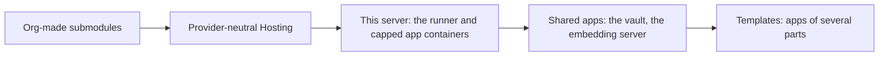

# Roadmap

This page lists what is left to build and the known faults. The other pages describe what Platform does now.

## Before wider use

- [ ] Turn on access enforcement (`ACCESS_ENFORCE=true`) on each deployment when its `access decision=would_deny` lines show no real callers.
- [ ] Move the SQLite deployments to Postgres with the copy script. Keep the SQLite file for one week of clean operation.
- [ ] Make `Check` a required status check on `main`.
- [ ] Check the RunPod request and response field names against the live RunPod API. The godfather and runpod modules are tested against a fake only.
- [ ] Tie Jeopardy to an org. It is global because the bot process has no command channel from the API.

## Shared submodules and hosting

The design is in the doc "Platform: shared submodules and This server hosting". Done: per-org limits and container caps (#334), shared submodules (#336), who pays (#339), one Feeds module (#340), the read-only host agent and the Services card, Alerts as a Core module, and the ASU sign-in on the ASU submodule.

- [ ] Org-made submodules: a manifest of pages and feeds made on the dashboard, approved by the superadmin before other orgs see it (`submodules.owned`).
- [ ] Provider-neutral Hosting: a `memory` field, `cpu` optional, no RunPod words where an app can run elsewhere.
- [x] This server: a hosting provider that runs each app as a capped container on the deployment's server, through the runner (`deploy/runner/`), with per-org app limits.
- [ ] An address for each This server app at `<app>-<org>.apps.thesoda.io`: a wildcard DNS record and certificate. Until then an app keeps a domain that Nginx Proxy Manager sends to its published port.
- [x] Move SoDA's services into This server apps: wiki, wtc, the website, Wayfinder and its database, the CRM (four parts), and the vault as a shared app.
- [x] Shared apps: apps the deployment owns on This server, which every org subscribes to. A vault subscription invites the org's people; each org keeps its items in its own Vaultwarden organization.
- [x] Move the vault (vault.thesoda.io) into a shared app.
- [x] Add the embedding server (Qwen3-Embedding-0.6B, llama.cpp) as a shared app. It is off by default: the deployment and the orgs keep their embedder until someone points theirs at it, which needs a re-embed.
- [ ] Templates that make several apps and link them.
- [ ] Take `canvas_url` from the org's subscribed submodules, not the deployment.
- [ ] Deployment-wide limits on shared submodule passages and embeddings.

## Core

- [ ] Terms and role assignments for each term. Officer access stops when the term stops.
- [ ] Handover: a list of the org's outside accounts and the role that owns each. Show an alert when that role is empty.
- [ ] Visibility levels on shared tables (public, member, officer, restricted), applied in queries.
- [ ] Sync cursors, so that a sync continues from where the last run stopped. `knowledge_runs` and `alert_runs` already log each run and its error.
- [ ] Webhooks that start jobs, at `/api/webhooks/<module>/<name>`.
- [ ] Dashboard pages for job history and retry.
- [ ] A member page for Godfather, so that members can see their pods and sessions without the CLI.
- [ ] Shared tracing for agents on Platform (OpenTelemetry, with a self-hosted viewer).

## Modules

| Module | Does |
| --- | --- |
| `events` | Native events, registration, QR check-in and attendance. Check-ins give points |
| `members` | Roster and memberships for each term, on the `users` tables |
| `announcements` | One message to Discord, Slack and email after an officer approves it |
| `github` | An org's repos and issues, and app manifests from them |
| `notion`, `google_drive` | Pages and documents as knowledge sources |
| `forms`, `csv`, `sheets` | Imports. The points CSV upload becomes one use of `csv` |
| `analytics` | Discord activity counts with hashed ids and an opt-out command. It never keeps message text |
| `slack` | Slack as a second chat platform |
| `sponsors`, `hackathon` | Sponsor records and hackathon logistics |

Campus content is a submodule in `submodules/`, such as `submodules/asu`. Another campus adds its own submodule the same way.

## Cleanup

- [x] Rename `modules/auth/decoraters.py` to `decorators.py`.
- [x] Move the `users` and membership tables and their helpers to `modules/users`, and the storefront queries to `modules/storefront/service.py`.
- [ ] Move the rest of the logic in `points/api.py` and `storefront/api.py` into their `service.py`.
- [ ] Remove dead routes: the camelCase aliases in points, `/api/users/<org>/submit-form`, `/api/public/getnextevent`, `/api/organizations/<id>/roles`, and the legacy calendar routes (`/events`, `/delete-all-events`, `/notion-webhook`).
- [ ] Remove the unused models `Session`, `OrganizationConfig` and `Officer`, and the unused columns `points_per_message` and `points_cooldown`.
- [ ] Make `superadmin` create orgs through `organizations.service.create_organization`, so that the prefix is checked.

## Known faults

- Checkout reads the points balance and writes the purchase with no row lock. Two checkouts at the same time can both pass the balance check.
- `error_handler` returns the exception text to the client.
- `GET /api/organizations/<id>/stats`, `/activity` and `/roles` return fixed sample data.
- `superadmin_required` accepts a session only with `role == "admin"`, which sign-in never sets. Only the header path works.
- `GameCog` uses `bot.guilds[0]`, the first server of the bot, not the org of the request. Game state is in memory and a restart loses it.
- The calendar sync needs the Notion properties `Name`, `Date`, `Location`, `Description` and `gcal_id`. If one has a different name, the sync skips the event and logs a warning.
- The points CSV upload gives no progress or result. Errors go only to the log.

## Not planned

- An agent that runs inside Platform. Agents are separate apps that call Platform with scoped tokens.
- Answer generation. Platform keeps and searches data; agents generate answers.
- Container orchestration for more than one pod for each app.
- Storage of Discord channel messages.

## Open questions

- [ ] Maintainers and CODEOWNERS for each module when more than one org contributes.
- [ ] Privacy defaults for agent data on each deployment: who can read conversations, and whether the 180-day retention must be shorter.
- [ ] Keep Flask, or move to FastAPI one blueprint at a time.
